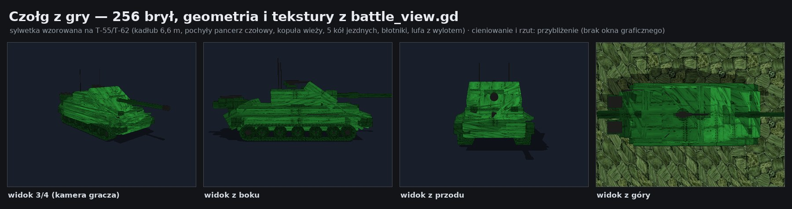
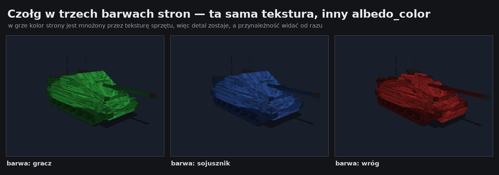
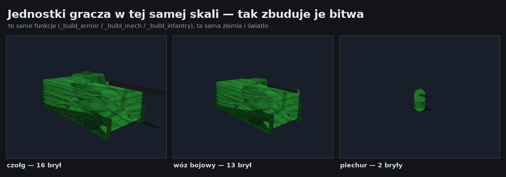

# Podglądy grafiki

Obrazki poglądowe generowane narzędziami z `tools/` — do oglądania bez
uruchamiania gry (środowisko robocze nie ma serwera graficznego, więc Godot
w `--headless` nie renderuje obrazu).

---

## Czołg z gry — 16 brył

Geometria i tekstury pochodzą **z gry**: zrzut robi skrypt, który woła te same
funkcje budujące świat bitwy co `battle_view.gd`. Cztery ujęcia, a pod nimi
wóz bojowy i piechur w tej samej skali oraz ta sama geometria w barwach stron.



## Ta sama tekstura, trzy barwy stron

W grze kolor strony jest mnożony przez teksturę sprzętu, więc detal (nity,
spoiny, ogniwa) zostaje, a przynależność widać od razu.



## Jednostki w jednej skali



---

## Tekstury terenu (13)

Sprowadzone programowo do jednej palety, więc mapa nie wygląda jak kolaż.


## Tekstury otoczenia bitwy (5)


## Tekstury sprzętu (2)


## Ikony mapy (6)


---

## Makiety

Mapa kampanii 60×40 z prawdziwego `tests/ref_map.json`, złożona z kafli gry,
z ikonami (wrogowie i zwiadowca to znaczniki przykładowe — rozgrywka jest losowa):


Tekstury otoczenia na bryłach, które buduje `battle_view.gd`:


Schemat brył pojazdów w skali 1:20:


---

## Co jest 1:1 z grą, a co przybliżeniem

| plik | wierność |
| --- | --- |
| arkusze tekstur, ikon i otoczenia | **1:1** — to wprost pliki z `assets/` |
| `mapa_kampanii_seed1` | **dane i kafle 1:1** — prawdziwy seed z `tests/ref_map.json`; wrogowie i zwiadowca to znaczniki przykładowe |
| `czolg_z_gry`, `czolg_barwy_stron`, `jednostki_skala` | **geometria, barwy i tekstury 1:1** z gry; oświetlenie i rzut to przybliżenie renderera (Godot inaczej tonuje obraz) — szczegóły w `tools/godot/README.md` |

## Odtworzenie

```bash
pip install numpy pillow

# tekstury i makiety
python3 tools/art/preview_textures.py --out /tmp/art/out
python3 tools/art/preview_textures.py --out /tmp/art/out --seed 42

# render jednostek z prawdziwej geometrii gry
godot --headless --path . -s res://tools/godot/dump_meshes.gd -- /tmp/art/units.json
python3 tools/art/render_units.py --meshes /tmp/art/units.json --out /tmp/art/out
```
