# Podglądy grafiki

Obrazki poglądowe generowane narzędziami z `tools/` — do oglądania bez
uruchamiania gry (środowisko robocze nie ma serwera graficznego, więc Godot
w `--headless` nie renderuje obrazu).

Wszystkie rendery poniżej powstają z **prawdziwej geometrii gry**: skrypt
`tools/godot/dump_meshes.gd` woła te same funkcje budujące świat bitwy, których
używa `battle_view.gd`, i zapisuje bryły do JSON-a. Renderer tylko je oświetla.

Sylwetki pojazdów (1024 bryły każdy) odwzorowują prawdziwe wozy z 1975 roku —
wzorcem były publiczne modele 3D z Sketchfaba (T-55A, T-62 Obr. 1972, T-72A,
M48A5/M60A1, M551, M113, BTR-60PB, BMP-1, MT-LB, MBT-70, Obiekt 775) oraz dane
wymiarowe z Wikipedii.

---

## Czołgi 1975 — cały park sprzętu w jednej skali

Sześć czołgów, każdy dokładnie **1024 bryły**, ale inne proporcje: M60A1
(wysoka wieża odlewana z koszem, lufa 105 mm, reflektor AN/VSS-1, 6 kół),
M551 Sheridan (niski, 5 dużych kół, napęd z przodu), **MBT-70** (płaska wieża
szersza od kadłuba, działo 152 mm i działko 20 mm w kopułce), T-62 Obr. 1972
(kopuła, 5 kół równo rozstawionych, rura do brodzenia OPVT), T-72 Ural (niski,
6 kół, rura snorkla), **Obiekt 775** (wieża-dysk, lemiesz, najniższy — 1,9 m):

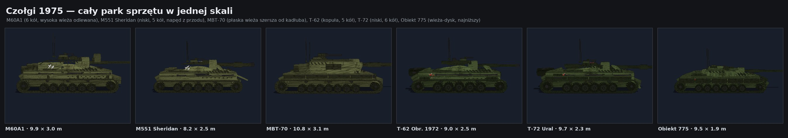

## Wozy bojowe — kołowy, gąsienicowe, każdy inny

M113 (pudełko z falochronem i rampą, napęd z przodu), BTR-60PB (osiem kół,
cztery osie na stronę — jedyny wóz kołowy w grze), BMP-1 (niski klin z
działkiem 73 mm i wyrzutnią 9M14), MT-LB (najniższy ciągnik). Każdy ma
**1024 bryły**:

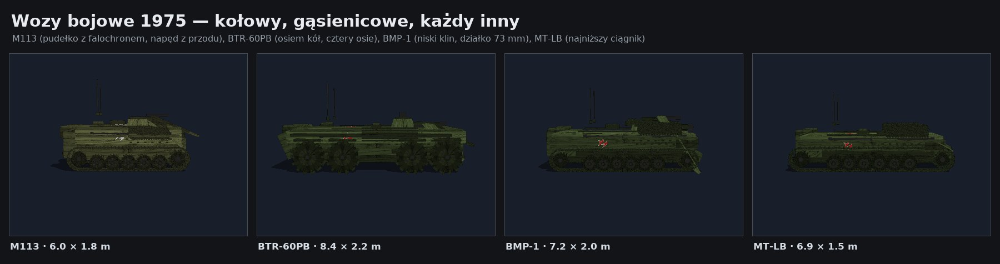

## M60A1 — 1024 bryły, cztery ujęcia

Ten sam wóz z kamery gracza, z boku, z przodu i z góry. Na dachu wieży jest
płaska gwiazda — tak jak w rzeczywistości malowano oznaczenia do identyfikacji
z powietrza; z boku widać gwiazdy na burtach kadłuba i wieży:

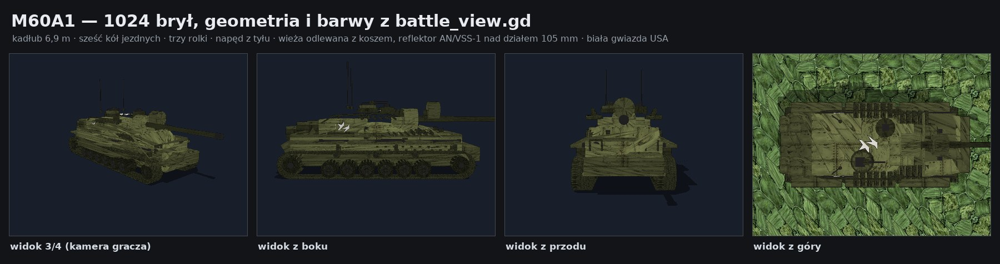

## Barwy fabryczne — stronę poznaje się po sylwetce i oznaczeniu

Wozy obu stron mają barwy fabryczne: olive drab USA i zieleń 4BO ZSRR.
Przynależność jednostki (gracz / sojusznik / wróg) pokazuje w bitwie
kolorowy pierścień na ziemi:

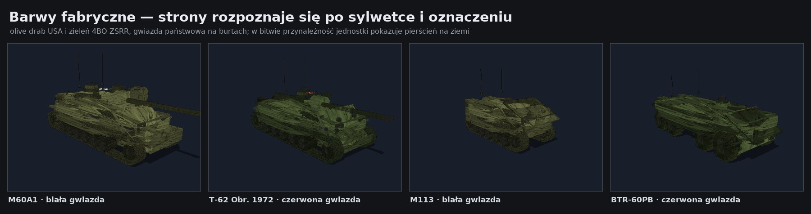

## Jednostki gracza w jednej skali

Czołg, wóz bojowy i piechur zbudowani tymi samymi funkcjami, które budują
świat bitwy (`_armor_parts` / `_mech_parts` / `_build_infantry`), na tym samym
gruncie i świetle:

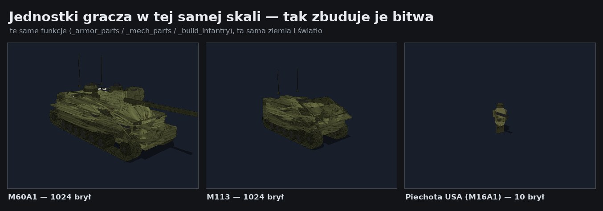

## Makieta pojazdów — rzut z boku, bryła po bryle

Orthograficzny rzut z boku z podziałką metrową: kontur powstaje z pojedynczych
brył (obrys), a gwiazdki to płytki oznaczeń państwowych na pancerzu. Widoczne
pojedyncze ogniwa gąsienic, koła jezdne, błotniki i reflektory:

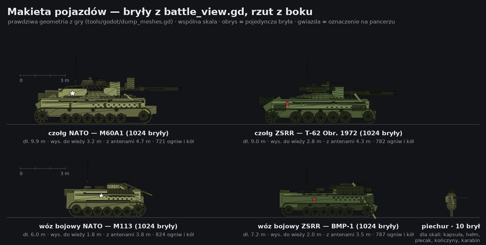

## Arkusze tekstur (grafika AI)

Tekstury jednolite kolorystycznie (tint-neutral), więc ta sama tekstura
służy obu stronom — barwę nadaje materiał w grze:

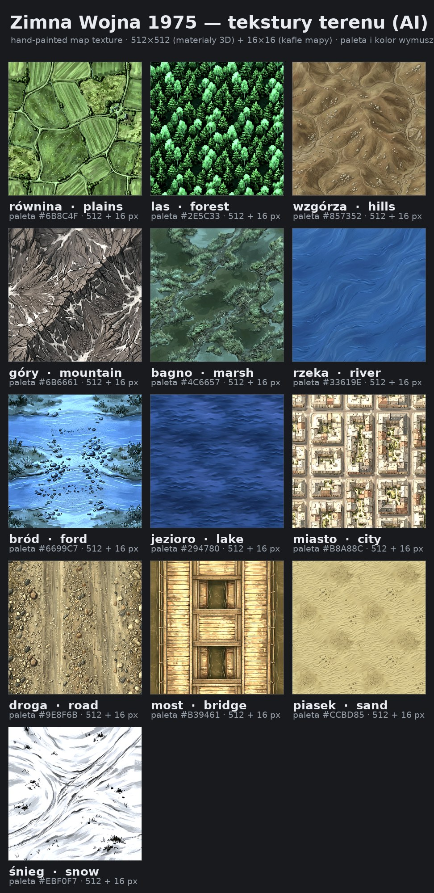

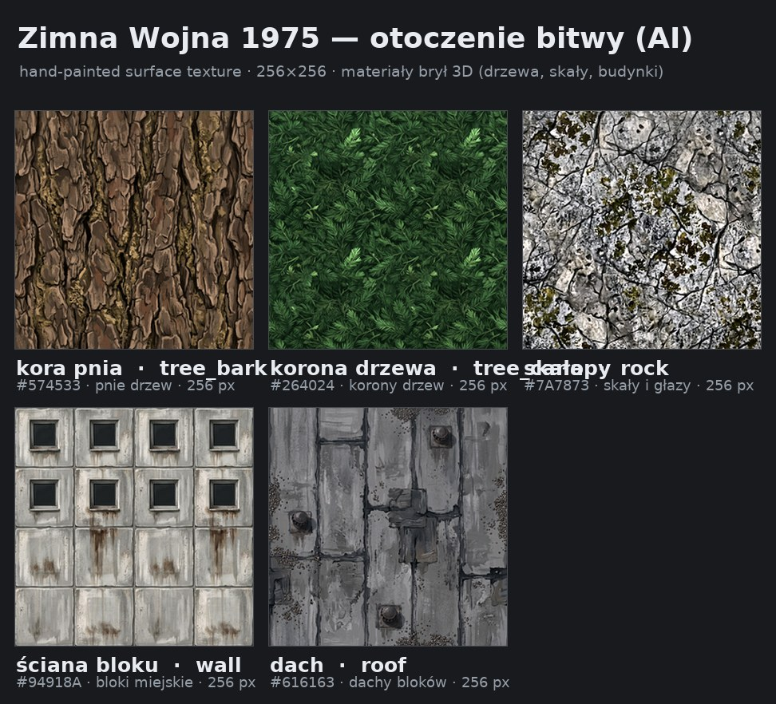

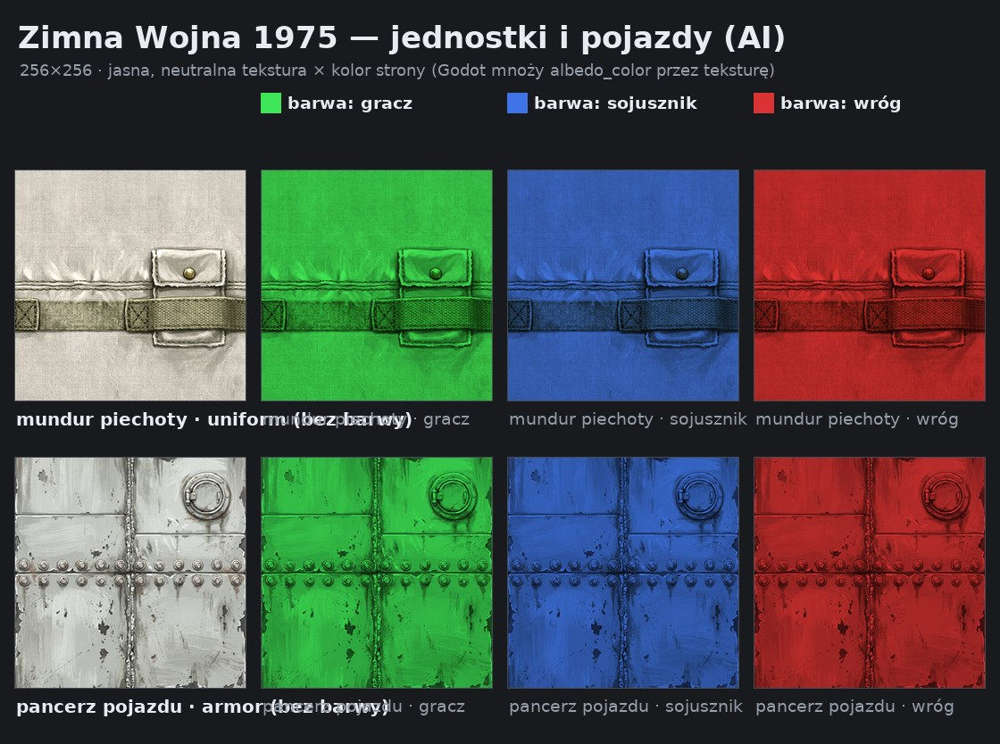

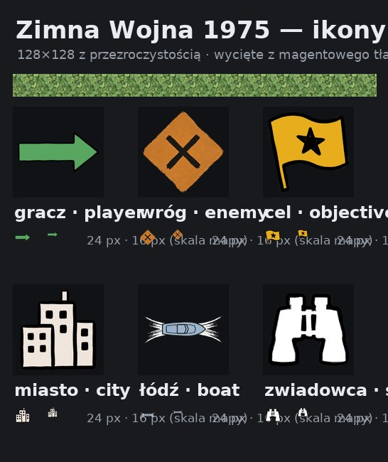

## Makiety scen

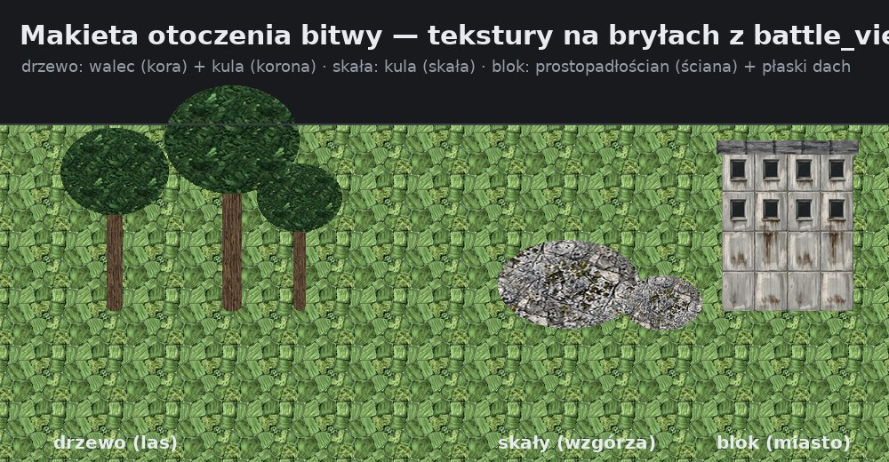

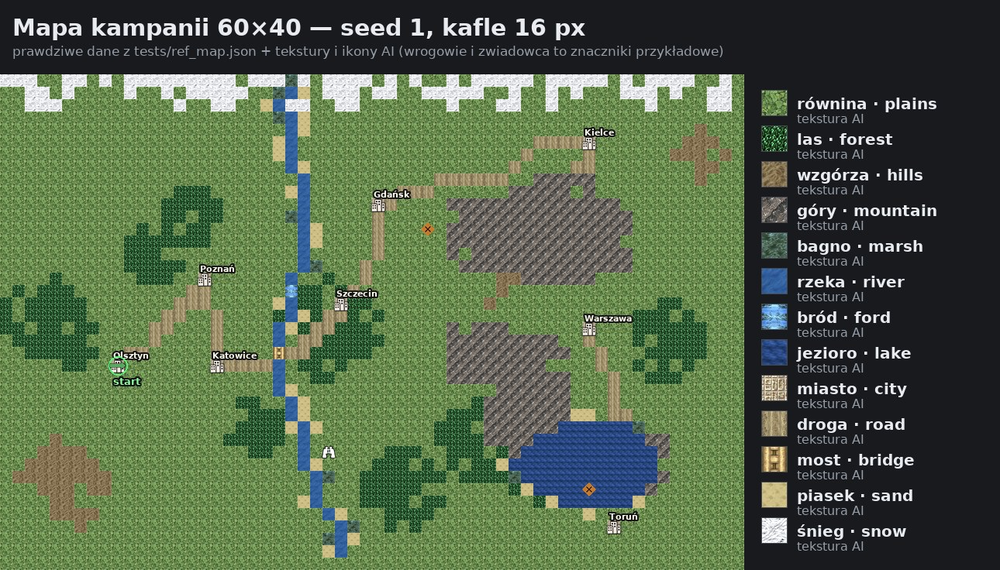

---

## Wierność odwzorowania

| Cecha            | Wierność                                              |
|------------------|-------------------------------------------------------|
| Geometria        | 1:1 z `battle_view.gd` (te same bryły, te same osie)   |
| Proporcje        | wg wymiarów rzeczywistych wozów (dł./szer./wys.)      |
| Barwy            | 1:1 z materiałów gry (olive drab / 4BO)               |
| Tekstury         | 1:1 z `assets/textures/` (grafika AI)                 |
| Oświetlenie      | przybliżone (renderer programowy, nie silnik gry)     |
| Rzut             | przybliżony (perspektywa kamery programowej)          |

To nie są zrzuty ekranu z gry — środowisko robocze nie ma GPU. Wszystko,
czego nie da się oddać headless (cienie, mgła, HDR), wygląda w grze lepiej.

## Odtworzenie

```bash
pip install --break-system-packages numpy pillow

# 1. zrzut geometrii z gry (wymaga binarki Godot 4.7)
godot --headless --path . -s res://tools/godot/dump_meshes.gd -- /tmp/art/units.json

# 2. rendery 3D i makiety
python3 tools/art/render_units.py --meshes /tmp/art/units.json --out /tmp/art/out
python3 tools/art/preview_textures.py --out /tmp/art/out --meshes /tmp/art/units.json --seed 42
```
